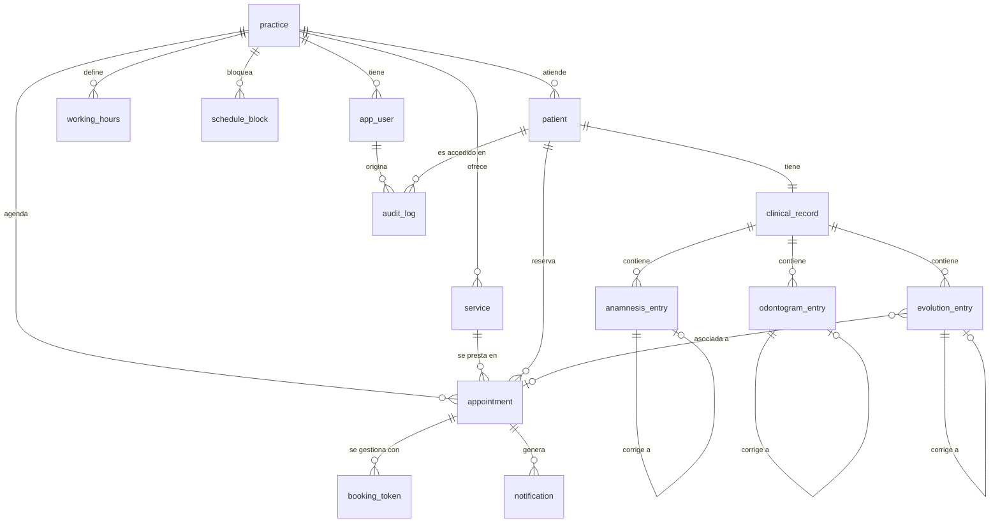

# Modelo de Datos

Modelo lógico propuesto (PostgreSQL). Los nombres de tablas/columnas están en inglés para el código; los términos de dominio en español van entre paréntesis. Todo lo marcado **Suposición:** puede ajustarse en el change de implementación.

## Dominios

| Dominio | Entidades | Módulo |
|---------|-----------|--------|
| Consultorio y acceso | `practice`, `app_user` | auth / configuración |
| Agenda | `service`, `working_hours`, `schedule_block`, `appointment`, `booking_token` | agenda, reservas |
| Pacientes | `patient` | pacientes |
| Historia clínica | `clinical_record`, `anamnesis_entry`, `odontogram_entry`, `evolution_entry` | historia clínica |
| Notificaciones | `notification` | notificaciones |
| Auditoría | `audit_log` | auth/auditoría |

## Preparación para multi-tenant (decisión DD-02)

- Existe una tabla `practice` con **una sola fila** en v1.
- Toda tabla de negocio lleva `practice_id` (FK a `practice`, NOT NULL, con valor único en v1). Costo: una columna e índices compuestos. Beneficio: la migración a multi-tenant no requiere reescribir el esquema.
- Las constraints de unicidad y exclusión incluyen `practice_id`.
- **Suposición:** no se implementa filtrado por tenant en v1 más allá de usar siempre el `practice_id` de la instalación.

## ERD



## Entidades

### practice (consultorio)
- `id` UUID PK; `name` text; `timezone` text (default `America/Argentina/Buenos_Aires`); `slot_granularity_min` int (default 15, **Suposición**); `min_notice_min` int (anticipación mínima de reserva, **Suposición**); `max_advance_days` int (horizonte de reserva, **Suposición**); `contact_email`, `contact_phone`, `address`; `created_at`.
- Constraint: en v1 una sola fila.

### app_user
- `id` UUID PK; `practice_id` FK; `email` text UNIQUE; `password_hash` text (Argon2id/bcrypt); `role` enum (`DENTIST`; `SECRETARY` reservado v2); `full_name`; `license_number` (matrícula profesional, TBD); `failed_attempts` int; `locked_until` timestamptz null; `created_at`, `last_login_at`.
- Método de autenticación final = pregunta abierta (ver 10).

### service (prestación)
- `id` UUID PK; `practice_id` FK; `name` text; `description` text; `duration_min` int CHECK > 0; `active` boolean (baja lógica); `public_visible` boolean; `created_at`, `updated_at`.
- Precio: **fuera de v1** (precios en ARS = pregunta abierta; se omite la columna hasta decidir).

### working_hours (horarios de atención)
- `id` UUID PK; `practice_id` FK; `weekday` smallint (1-7); `start_time` time; `end_time` time CHECK end > start.
- Permite varios tramos por día (ej. mañana y tarde). Sin solapamiento de tramos del mismo día (validación de aplicación).

### schedule_block (bloqueo)
- `id` UUID PK; `practice_id` FK; `starts_at`, `ends_at` timestamptz CHECK ends > starts; `reason` text; `created_at`.
- Constraint opcional: `EXCLUDE` entre bloqueos para evitar duplicados (no crítico).

### patient
- `id` UUID PK; `practice_id` FK; `first_name`, `last_name`; `dni` text; `phone`; `email`; `birth_date` date null; `address` null; `created_at`, `updated_at`; `source` enum (`PUBLIC_BOOKING`, `MANUAL`).
- Unicidad: `UNIQUE (practice_id, dni)` — **Suposición:** el paciente se identifica por DNI; una reserva pública con DNI existente se asocia a ese paciente **sin** modificar sus datos ya cargados por el profesional (evita sobreescritura por un tercero; ver RN-PA-03).
- Dato personal; el DNI y los de contacto son datos personales (Ley 25.326).

### appointment (turno)
- `id` UUID PK; `practice_id` FK; `patient_id` FK; `service_id` FK; `starts_at`, `ends_at` timestamptz (UTC en BD; `ends_at = starts_at + duration`, duración copiada del servicio al reservar como `duration_min_snapshot`); `status` enum (`CONFIRMED`, `CANCELLED`, `COMPLETED`, `NO_SHOW`); `origin` enum (`PUBLIC`, `INTERNAL`); `cancelled_by` enum (`PATIENT`, `DENTIST`) null; `cancelled_at` null; `notes` text null; `created_at`, `updated_at`.
- **Constraint anti-solapamiento (RN-AG-01):**
  ```sql
  CREATE EXTENSION IF NOT EXISTS btree_gist;
  ALTER TABLE appointment ADD CONSTRAINT appointment_no_overlap
    EXCLUDE USING gist (
      practice_id WITH =,
      tstzrange(starts_at, ends_at, '[)') WITH &&
    ) WHERE (status = 'CONFIRMED');
  ```
  Solo turnos `CONFIRMED` bloquean el horario; cancelados liberan el slot. Los turnos `COMPLETED`/`NO_SHOW` **Suposición:** deben seguir bloqueando su rango histórico, por lo que el `WHERE` podría ser `status <> 'CANCELLED'`; decidir en el change.
- El solapamiento con `schedule_block` y con horario fuera de atención **no** lo cubre la constraint (están en otras tablas): se valida en aplicación dentro de la misma transacción. Alternativa a evaluar: modelar bloqueos como filas de una tabla común de "ocupación".
- Índices: `(practice_id, starts_at)`, `(patient_id)`, `(status, starts_at)` para el job de recordatorios.

### booking_token
- `id` UUID PK; `appointment_id` FK; `token_hash` text UNIQUE (se guarda el hash SHA-256, nunca el token en claro); `expires_at` timestamptz; `revoked_at` null; `created_at`.
- El token en claro (≥128 bits de entropía, CSPRNG) viaja solo en el link del email. Ver RN-RS-04..06.

### notification
- `id` UUID PK; `appointment_id` FK; `type` enum (`CONFIRMATION`, `REMINDER`, `CANCELLATION`, `RESCHEDULE`); `channel` enum (`EMAIL`; `WHATSAPP` reservado v2); `scheduled_for` timestamptz; `sent_at` null; `status` enum (`PENDING`, `SENT`, `FAILED`); `attempts` int; `last_error` text null.
- `UNIQUE (appointment_id, type)` para el recordatorio, garantizando idempotencia (RN-NO-03).

### clinical_record (historia clínica)
- `id` UUID PK; `practice_id` FK; `patient_id` FK UNIQUE; `opened_at`.
- Contenedor lógico; el contenido son entradas inmutables.

### anamnesis_entry
- `id` UUID PK; `clinical_record_id` FK; `version` int; `content` jsonb (antecedentes, alergias, medicación, patologías, hábitos; estructura TBD); `corrects_entry_id` FK propia null; `correction_reason` text null; `author_id` FK `app_user`; `created_at` timestamptz.
- Inmutable: sin UPDATE ni DELETE (ver RN-HC-01).

### odontogram_entry
- `id` UUID PK; `clinical_record_id` FK; `tooth_code` text (notación FDI, **Suposición**); `surface` text null; `condition` enum/text (sano, caries, obturación, ausente, corona, etc.; catálogo TBD); `notes`; `corrects_entry_id` FK propia null; `correction_reason`; `author_id`; `created_at`.
- El estado actual del odontograma se **deriva** de la última entrada vigente por diente/superficie, preservando el historial.

### evolution_entry (evolución)
- `id` UUID PK; `clinical_record_id` FK; `appointment_id` FK null; `description` text (no vacía, ≤ 5000); `corrects_entry_id` FK propia null; `correction_reason` (≤ 500); `author_id`; `created_at`.
- **Desvío respecto de la versión original (S-EV-01, C-18)**: no existe `performed_at`; la única fecha es `created_at`, fijada por el servidor. Si una atención se carga después, el turno asociado da la fecha de atención. Agregar `performed_at` más adelante es una migración aditiva (nullable). Pendiente de confirmar con el profesional (S-EV-01..03).

### audit_log
- `id` bigint PK; `practice_id`; `user_id` FK null (null = anónimo/sistema); `action` enum (`HC_READ`, `HC_CREATE`, `HC_CORRECT`, `PATIENT_READ`, `PATIENT_UPDATE`, `LOGIN_OK`, `LOGIN_FAIL`, `BOOKING_TOKEN_USE`, ...); `entity_type`, `entity_id`; `patient_id` null; `ip` inet; `user_agent` text; `occurred_at` timestamptz; `details` jsonb (sin datos clínicos en claro).
- Append-only: permisos de BD sin UPDATE/DELETE para el rol de la aplicación. Retención TBD (ver 10/11).

## Seed data inicial

| Dato | Contenido |
|------|-----------|
| `practice` | 1 fila con nombre y zona horaria `America/Argentina/Buenos_Aires` |
| `app_user` | 1 usuario `DENTIST` creado por script/variable de entorno de bootstrap (contraseña inicial obligatoria de cambiar en el primer login; **no** versionada) |
| `working_hours` | Lunes a viernes 09:00-13:00 y 14:00-18:00 (**Suposición:** valores de ejemplo, editables) |
| `service` | Consulta/control (30 min), Limpieza (45 min), Obturación (60 min), Urgencia (30 min) (**Suposición:** ejemplos editables) |
| Catálogo odontograma | Estados dentales básicos (sano, caries, obturado, ausente, corona, endodoncia) en notación FDI |
| Datos de desarrollo | Pacientes y turnos ficticios solo en perfil `dev`; **nunca** datos reales en entornos de prueba |
